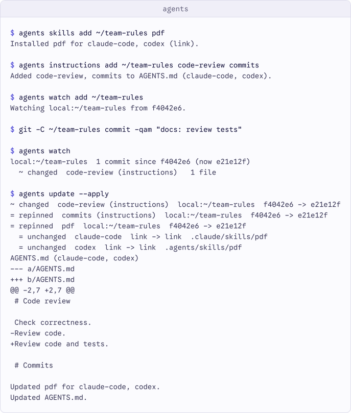

<p align="center">
  <a href="https://github.com/agents-tools/cli">
    
  </a>
</p>

<h1 align="center">agents</h1>

<p align="center">
  Install and update agent skills and instructions, resolved to exact versions.
</p>

<p align="center">
  <a href="https://github.com/agents-tools/cli/actions/workflows/ci.yml"></a>
  <a href="Package.swift"></a>
  <a href="Package.swift"></a>
  <a href="LICENSE"></a>
</p>

<p align="center">
  <a href="#overview">Overview</a> ·
  <a href="#quick-look">Quick look</a> ·
  <a href="#install">Install</a> ·
  <a href="#usage">Usage</a> ·
  <a href="#requirements">Requirements</a> ·
  <a href="#documentation">Documentation</a> ·
  <a href="#contributing">Contributing</a> ·
  <a href="#license">License</a>
</p>

## Overview

Declare skills and instruction sections once, restore their locked content with
`install`, and preview upstream changes before applying an update. `agents`
supports Codex, Claude Code, Cursor, Gemini CLI, and OpenCode through
[agents-tools/core](https://github.com/agents-tools/core).

The executable owns commands and terminal presentation. Core owns source
resolution, declarations, locks, discovery, installation, and recovery.

## Quick look

Install a skill and two instruction sections, watch their source, then apply
an upstream change:

<p align="center">
  <picture>
    <source media="(prefers-color-scheme: dark)"
            srcset=".github/assets/terminal/terminal-dark.svg">
    
  </picture>
</p>

## Install

Install the latest release from the Homebrew tap:

```sh
brew install agents-tools/tap/agents
agents --help
```

For a development build of `master`, use:

```sh
brew install --HEAD agents-tools/tap/agents
```

See the [tap documentation](https://github.com/agents-tools/homebrew-tap#readme)
for packaging and channel details.

To build from source instead:

```sh
git clone https://github.com/agents-tools/cli.git
cd cli
swift build -c release
.build/release/agents --help
```

Place `.build/release/agents` in a directory on your `PATH`. To run from this
checkout, use `.build/release/agents` or `swift run agents`.

## Usage

```sh
agents skills add https://github.com/anthropics/skills.git --all --agent codex
agents skills list
agents skills list --scope user --json
agents instructions add /path/to/rules canonical-artifacts
agents instructions list
agents instructions update --apply
agents instructions render chatgpt weekly | pbcopy
agents watch add https://github.com/anthropics/skills.git
agents watch
agents watch diff https://github.com/anthropics/skills.git
agents watch seen https://github.com/anthropics/skills.git
agents install
agents update
agents update --apply
agents skills remove pdf
agents skills init my-skill
agents doctor --root /path/to/project-a /path/to/project-b --json
```

Project scope is the default and uses the current directory. User scope is
selected with `--scope user`. Commands never prompt for confirmation.

`watch` subscribes to sources without installing content, reports upstream
changes since the last `watch seen`, and previews file differences. Removing a
subscription with `watch remove` keeps installed skills and instructions.

Instructions are Markdown sections discovered in a source's `instructions/` or
`.agents/instructions/` directory. Managed blocks preserve surrounding custom
content in agent files, with Claude forwarding where needed. `--agent` on
instructions add, remove, or update sets the recipients of the scope's entire
section list. `agents instructions init <name>` creates `<name>.md`.

Named ChatGPT prompts are declared in `agents.json` and locked with
`agents instructions update --apply`; render emits only their locked sections
and optional custom content. Updates identify changed prompts to re-paste.
Top-level `install`, `update`, and `doctor` process skills then instructions,
including combined `--json` reports.

## Requirements

- macOS 13 or later.
- Swift 6.3 or later to build from source.
- Git for Git-backed sources.

## Documentation

The [documentation index](Documentation/README.md) links the command reference,
JSON schemas, and release checklist. Start with the
[CLI reference](Documentation/Reference/CLI.md) for options, state locations,
output, and exit codes. See the [changelog](CHANGELOG.md) for user-visible changes.

## Contributing

Read the organization's
[contributing guide](https://github.com/agents-tools/.github/blob/master/CONTRIBUTING.md)
and [maintenance change flow](https://github.com/agents-tools/.github/blob/master/MAINTENANCE.md#change-flow),
then follow the repository's [development instructions](#development) below.

### Development

```sh
swift build
env -u CODEX_HOME -u CLAUDE_CONFIG_DIR -u XDG_CONFIG_HOME -u XDG_STATE_HOME -u XDG_CACHE_HOME swift test
swift build -c release
xcrun swift-format lint --strict --configuration .swift-format --recursive Package.swift Sources Tests
git diff --check origin/master
```

Executable tests create local Git sources and isolated homes in the system
temporary directory. Every child process uses an explicit environment rather
than inheriting agent or Git configuration. Fixtures are removed after tests.

Core follows `master` during development. To use a local core worktree without
changing the package manifest:

```sh
swift package resolve
swift package edit core --path /path/to/core-worktree
swift test
swift package unedit core
```

Keep the local edit inside your authorized development scope. Releases switch
to a version range according to the
[release checklist](Documentation/Reference/Release.md).
The CLI version is defined once in `Sources/CLI/EntryPoint.swift`.

### Continuous integration

The workflows run on branch pushes, pull requests, and manual dispatch. Source
policy also runs when a pull-request title changes. The required contexts are
declared in the organization's
[maintenance standard](https://github.com/agents-tools/.github/blob/master/MAINTENANCE.md#activation-and-required-checks):

| Context | Validation |
| --- | --- |
| `policy / policy` | Conventional Commit subjects, PR title, and added-line policy |
| `validate / swift-package` | Strict format lint, debug build, tests, release build, and diff check |
| `smoke` | Release executable help, version, and unknown-command exit code 64 in an isolated environment |
| `presentation / presentation` | Built executable re-records `.github/assets/terminal/script.yml`; recording and both SVGs match byte for byte |

Shared workflows are pinned together to a reviewed full commit SHA. Follow the
[integration guide](https://github.com/agents-tools/.github/blob/master/Documentation/Reference/WorkflowIntegration.md)
when updating them, and verify the exact contexts on the candidate's real run.
For workflow edits, run `actionlint` (or parse every workflow as YAML) alongside
the development checks above. Weekly Dependabot updates cover Swift packages
and GitHub Actions.

## License

agents is available under the [MIT License](LICENSE).
