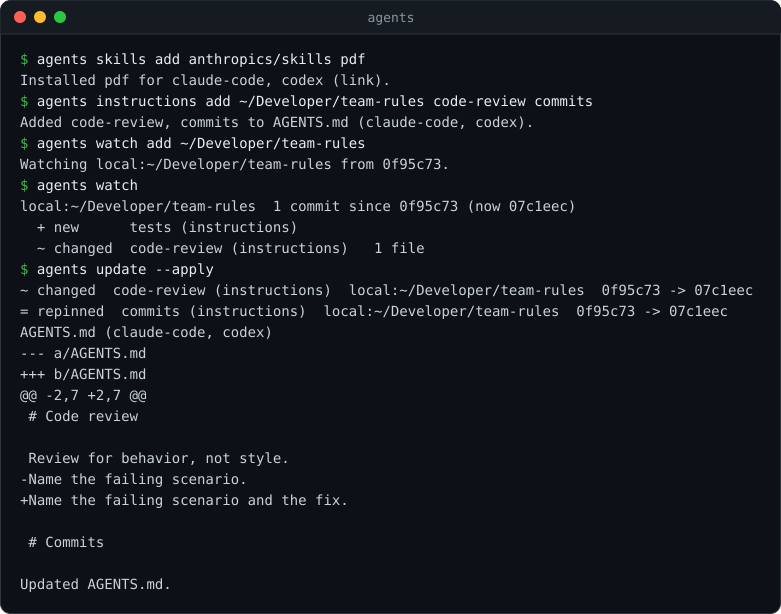

<p align="center">
  
</p>

<h1 align="center">agents</h1>

<p align="center">
  Skills and instructions for every agent, from sources you declare.
</p>

<p align="center">
  <a href="https://github.com/agents-tools/cli/actions/workflows/ci.yml"></a>
  
  
  <a href="LICENSE"></a>
</p>

`agents` manages agent skills and instructions from declared sources. Declare
skills and instruction sections once, restore their exact locked content with
`install`, and preview upstream changes before applying an update. It supports
Codex, Claude Code, Cursor, Gemini CLI, and OpenCode through
[agents-tools/core](https://github.com/agents-tools/core).

<p align="center">
  
</p>

The executable owns commands and terminal presentation. Core owns source
resolution, declarations, locks, discovery, installation, and recovery.

## Build and Run

Requires macOS 13 or later and Swift 6.3 or later. Build from source:

```sh
git clone https://github.com/agents-tools/cli.git
cd cli
swift build -c release
.build/release/agents --help
```

The examples below use `agents` as the executable name; from this checkout,
use `.build/release/agents` or `swift run agents`.

```sh
agents skills add https://github.com/anthropics/skills.git --all --agent codex
agents skills list
agents skills list --scope user --json
agents instructions add /path/to/rules canonical-artifacts
agents instructions list
agents instructions update --apply
agents instructions render chatgpt weekly | pbcopy
agents watch add https://github.com/anthropics/skills.git
agents watch
agents watch diff https://github.com/anthropics/skills.git
agents watch seen https://github.com/anthropics/skills.git
agents install
agents update
agents update --apply
agents skills remove pdf
agents skills init my-skill
agents doctor --root /path/to/project-a /path/to/project-b --json
```

Project scope is the default and uses the current directory. User scope is
selected with `--scope user`. Commands never prompt for confirmation.

`watch` subscribes to sources without installing content, reports upstream
changes since the last `watch seen`, and previews file differences. Removing a
subscription with `watch remove` keeps installed skills and instructions.

Instructions are Markdown sections discovered in a source's `instructions/` or
`.agents/instructions/` directory. Managed blocks preserve surrounding custom
content in agent files, with Claude forwarding where needed. `--agent` on
instructions add, remove, or update sets the recipients of the scope's entire
section list. `agents instructions init <name>` creates `<name>.md`.

Named ChatGPT prompts are declared in `agents.json` and locked with
`agents instructions update --apply`; render emits only their locked sections
and optional custom content. Updates identify changed prompts to re-paste.
Top-level `install`, `update`, and `doctor` process skills then instructions,
including combined `--json` reports.
See the [CLI reference](Documentation/Reference/CLI.md) for options, state
locations, JSON schemas, and exit codes.

## Development

```sh
swift build
env -u CODEX_HOME -u CLAUDE_CONFIG_DIR -u XDG_CONFIG_HOME -u XDG_STATE_HOME -u XDG_CACHE_HOME swift test
swift build -c release
xcrun swift-format lint --strict --configuration .swift-format --recursive Package.swift Sources Tests
git diff --check origin/master
```

Executable tests create local Git sources and isolated homes in the system
temporary directory. Every child process uses an explicit environment rather
than inheriting agent or Git configuration. Fixtures are removed after tests.

Core follows `master` during development. To use a local core worktree without
changing the package manifest:

```sh
swift package resolve
swift package edit core --path /path/to/core-worktree
swift test
swift package unedit core
```

Keep the local edit inside your authorized development scope. Releases switch
to a version range according to the
[release checklist](Documentation/Reference/Release.md).
The CLI version is defined once in `Sources/CLI/EntryPoint.swift`.

[Documentation](Documentation/README.md) indexes the command reference and schemas.
